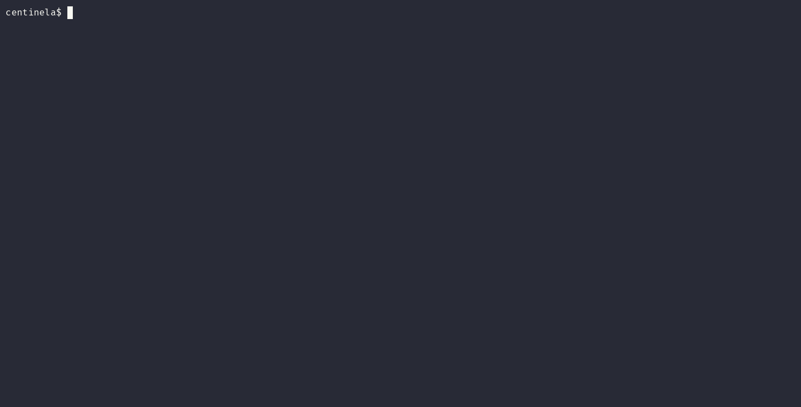
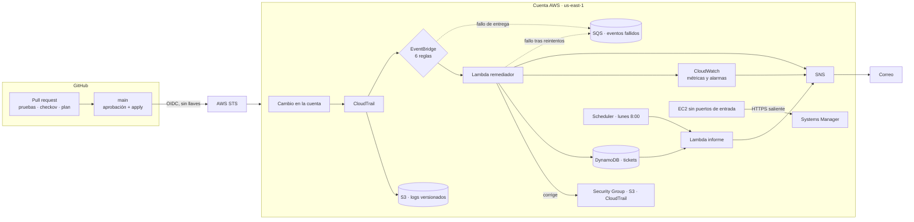

# Centinela · Respuesta automática a incidentes de seguridad en AWS


Centinela vigila una cuenta de AWS, detecta 7 tipos de incidentes de seguridad
y corrige automáticamente los 3 que se pueden revertir sin riesgo. Cada incidente
queda como ticket, con su técnica de MITRE ATT&CK y un runbook para la persona
que lo atiende. Todo se despliega con Terraform desde GitHub Actions, sin
credenciales de larga duración.



## Qué detecta y cómo responde

| Incidente                                               | Severidad | Respuesta                   | MITRE ATT&CK |
| ------------------------------------------------------- | --------- | --------------------------- | ------------ |
| Security Group abierto a internet en un puerto sensible | ALTA      | Revoca la regla             | T1562.007    |
| Bucket S3 sin bloqueo de acceso público                 | ALTA      | Reactiva el bloqueo         | T1530        |
| CloudTrail detenido                                     | CRÍTICA   | Lo vuelve a encender        | T1562.008    |
| CloudTrail eliminado                                    | CRÍTICA   | Ticket para revisión humana | T1562.008    |
| Inicio de sesión con la cuenta root                     | CRÍTICA   | Ticket para revisión humana | T1078.004    |
| Access key nueva                                        | MEDIA     | Ticket para revisión humana | T1098.001    |
| Inicio de sesión fallido                                | MEDIA     | Ticket para revisión humana | T1110        |

Solo se corrige automáticamente lo que es reversible, rara vez legítimo y no
puede romper un uso válido. El criterio completo está en
[docs/decisiones.md](docs/decisiones.md).

## Resultados

- **Tiempo de respuesta (mediana de 7 corridas):** CloudTrail 3 s · Security Group 5 s · Bucket S3 7 s.
  Ninguna corrección tardó más de 11 s.
- **Pruebas:** 17 pruebas unitarias con pytest y moto, en cada pull request.
- **Análisis de seguridad:** 233 checks de checkov en verde, incluidos los recursos opcionales;
  26 excepciones, cada una justificada en `.checkov.yaml`.
- **Infraestructura:** 48 recursos gestionados con Terraform, desplegados solo desde el pipeline.
- **Operación:** 6 reglas de detección, 7 runbooks y 4 alarmas (7 con el servidor encendido).
- **Costo:** unos USD 0,20 al mes con el servidor apagado (las solicitudes a S3 de CloudTrail);
  todo lo demás entra en la capa gratuita.

## Arquitectura



**Cómo se atiende un incidente:**

1. Alguien abre el puerto 22 a internet. CloudTrail registra la llamada a la API.
2. EventBridge compara el evento con sus reglas y, si coincide, invoca la Lambda.
3. La Lambda consulta el estado real del recurso. Si es un incidente, lo corrige.
4. Registra un ticket en DynamoDB (con un ID derivado del evento, para no duplicarlo
   si llega dos veces), publica métricas y envía un correo con el runbook.
5. Si la corrección falla, la Lambda reintenta; si sigue fallando, el evento queda
   en una cola SQS y una alarma avisa.

## Seguridad del propio proyecto

- **Sin credenciales de larga duración en el pipeline:** GitHub Actions entra a AWS con OIDC.
  La confianza está limitada a este repositorio, por su ID inmutable.
- **Mínimo privilegio:** el rol de la Lambda puede cerrar puertos, pero no abrirlos; puede
  encender CloudTrail, pero no apagarlo.
- **Aprobación humana:** el plan corre en cada PR con un rol de solo lectura; el apply
  solo desde `main` y después de una aprobación.
- **Servidor sin SSH:** sin reglas de entrada, IMDSv2 obligatorio, acceso solo con
  Session Manager y cada sesión registrada en CloudWatch Logs.
- **Runbooks ejecutables protegidos contra inyección de comandos:** los documentos de
  Systems Manager validan sus parámetros con una expresión regular antes de ejecutarse.

## Decisiones y limitaciones

Las decisiones de diseño, con sus alternativas y su costo, están en
[docs/decisiones.md](docs/decisiones.md). Las principales limitaciones:

- **Detección regional:** las reglas de EventBridge solo ven eventos de `us-east-1`.
  CloudTrail registra todas las regiones, pero la respuesta automática no las cubre.
- **Ventana ciega:** entre un `StopLogging` y su corrección pasan unos segundos sin registro.
- **Un administrador puede desactivar Centinela:** la protección completa requiere SCPs
  de AWS Organizations, que este proyecto no usa.
- **Logins fallidos sin umbral:** se registra cada fallo; un SOC real alertaría por
  umbral (por ejemplo, 5 fallos en 10 minutos desde la misma IP).
- **Las pruebas no cubren IAM ni EventBridge:** moto no evalúa permisos ni patrones.
  Eso lo valida el simulador (`scripts/simular-ataque.sh`) contra la cuenta real.

## Costos

| Componente                                                  | Costo mensual                   |
| ----------------------------------------------------------- | ------------------------------- |
| CloudTrail, Lambda, EventBridge, DynamoDB, SNS, SQS         | USD 0 (capa gratuita)           |
| S3: solicitudes de CloudTrail y del estado de Terraform     | ~USD 0,20                       |
| CloudWatch: 4 métricas propias, 4 alarmas, 1 dashboard      | USD 0 (capa gratuita)           |
| Servidor EC2 opcional (t3.micro, IP pública, disco de 8 GB) | ~USD 12, solo si está encendido |

## Cómo desplegarlo

1. `bootstrap/`: crea el bucket del estado y los roles OIDC (`terraform apply`, una vez).
   En `terraform.tfvars` van tu repositorio y los IDs numéricos de tu cuenta y del
   repositorio de GitHub, porque GitHub los incluye en el `sub` del token OIDC.
2. Configura en GitHub las variables `AWS_ROLE_PLAN`, `AWS_ROLE_APPLY`,
   `TF_STATE_BUCKET`, el secreto `EMAIL_ALERTAS` y el environment `produccion`.
3. Abre un pull request: el pipeline prueba, analiza y planifica. Al hacer merge,
   aprueba el despliegue.
4. Valida con `bash scripts/simular-ataque.sh`.

## Estructura

```
├── bootstrap/        Estado remoto y roles OIDC (se aplica una vez, en local)
├── infra/            Infraestructura de Centinela (la aplica el pipeline)
├── lambdas/          Remediador e informe semanal (Python)
├── tests/            Pruebas con pytest y moto
├── scripts/          Simulación de ataques, limpieza y gestión de tickets
├── runbooks/         Qué hacer ante cada tipo de incidente
├── docs/             Decisiones, lecciones y demo
└── .github/          Pipeline de CI/CD y Dependabot
```

## Lo que aprendí

Los errores reales que encontré, cómo los diagnostiqué y qué aprendí de cada uno
están en [docs/lecciones.md](docs/lecciones.md).

- Un mensaje de error genérico se resuelve mirando el dato real: así encontré que GitHub
  incluye IDs inmutables en el token OIDC.
- "En verde" no significa "seguro": mi análisis de seguridad no revisaba los recursos opcionales.
- Revisar la factura por servicio me mostró que el 92 % del gasto venía de un recurso ajeno
  al proyecto, por un recargo de soporte extendido de RDS.

## Próximos pasos

- Detección multirregión con un bus central de EventBridge.
- Umbral para logins fallidos con un contador en DynamoDB.
- Validar las detecciones con Stratus Red Team.
- Integración con AWS Security Hub.
